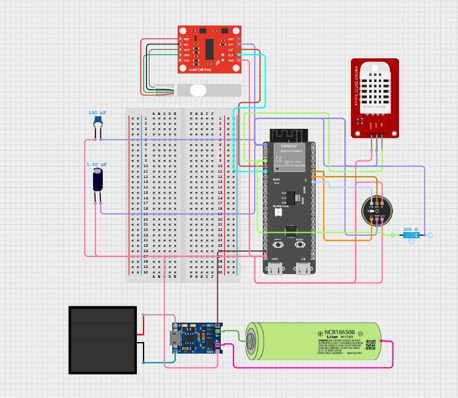
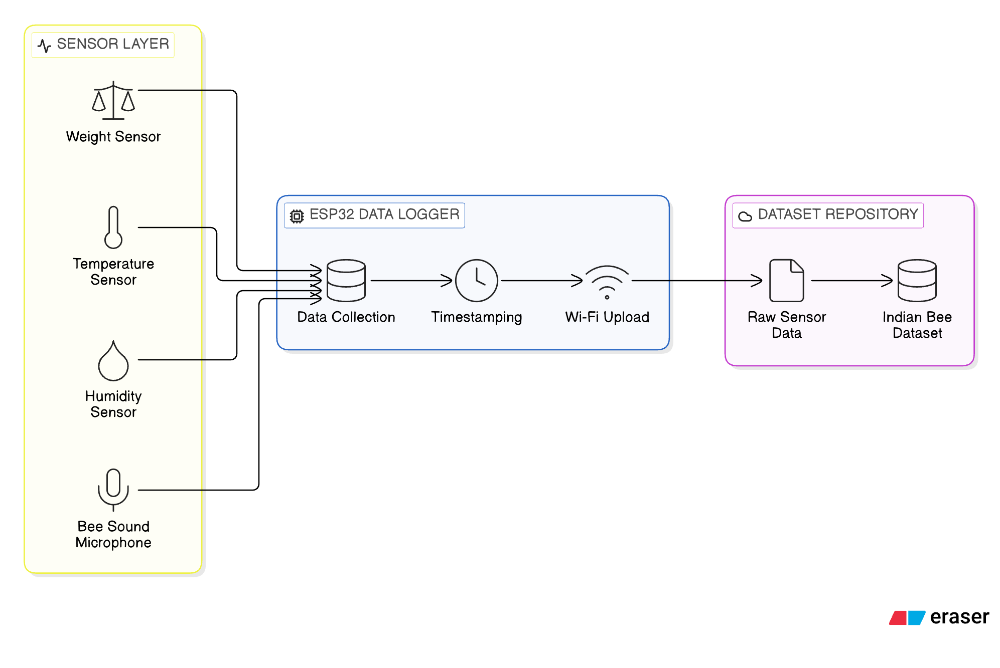

# Beehive Monitoring System

BeeHive is an IoT-based smart beekeeping system that monitors the health and environment of a honeybee colony in real time.

It uses an ESP32-based sensor node to collect temperature, humidity, hive weight, and bee acoustic data from sensors placed inside or around the hive. The data is sent over Wi-Fi to a Python-based receiver, where it can be logged, stored, visualized, and analyzed. The project is designed to reduce unnecessary hive disturbance and support AI-assisted detection of abnormal colony conditions.

## What it does

- Tracks hive environment conditions such as temperature and humidity
- Measures hive weight to detect changes in colony activity or health
- Captures bee sounds using a microphone for acoustic monitoring
- Sends sensor readings wirelessly to a central system
- Stores and analyzes data for beekeeping insights
- Supports AI-based monitoring for early detection of unusual hive behavior

## Hardware

ESP32 — Sensor processing and Wi-Fi communication

DHT22 — Temperature and humidity

Load Cell + HX711 — Hive weight measurement

INMP441 — Digital acoustic monitoring

## AI Pipeline
INMP441
   ↓
Audio Samples
   ↓
Preprocessing / MFCC
   ↓
ML Model
   ↓
Bee Activity / Anomaly Detection

## Circuit Diagram
 

## Flowchart

## Contributors
* Shivam Shetty
* Poornananda
* Shreya S Naik
* Prerana Shetty